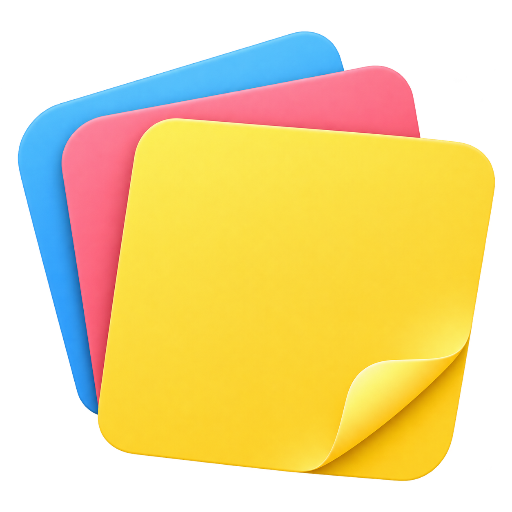
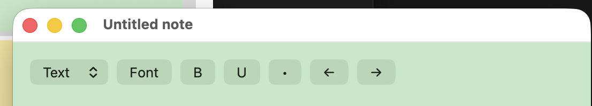
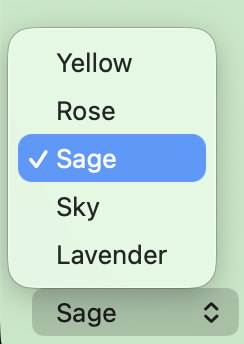

<div align="center">
  

# Sticky Notes

**A little space for ideas, reminders, and everything in between.**

A native macOS app with colorful notes, rich text, images, and a quiet place to keep them all.


</div>

## At a glance

Create a note, give it a color, and start writing. Edits save automatically. Closing a note keeps it in **My Notes**, ready to open again with a double-click.

- **Your notes, on your Mac.** No account, cloud service, or subscription required.
- **An independent window for every note.** Resize it, keep it above other windows, or close it for later.
- **A familiar native editor.** Fonts, headings, images, and writing direction use macOS text-editing foundations.

## Screenshots

Real screenshots of the app supplied during development. These detail views show an **earlier build**: the current release has a color-matched title bar, color swatches in the picker, and additional image and column controls.

### A compact writing toolbar



### Five note colors



## Features

### Notes that stay with you

- Five colors: **Yellow, Rose, Sage, Sky, and Lavender**.
- **My Notes** displays saved notes with their titles and modification times.
- Single-click to select; double-click to open.
- Automatic local saving after edits and when a note closes.
- A confirmation before permanently deleting a note.
- Independently resizable windows, with a minimum size that keeps all controls visible.

### Rich text, without a separate document app

- Native font picker, **bold**, underline, and bullet insertion.
- **Text, H1, H2, and H3** styles.
- Left and right alignment, plus left-to-right and right-to-left writing.
- **One or two continuous text columns** sharing the same document.
- Click an empty second column to start writing there. Switching back to one column brings all text together in order.
- Standard copy, cut, paste, select-all, and text undo shortcuts.

### Images inside your notes

- Add images with the **Image** button, paste them, or drag image files into a note.
- Click an image to select it; press **Delete** to remove it.
- Drag the selected image's lower-right blue handle to resize it.
- Use **Resize image** to enter a precise width while preserving its proportions.
- Images are embedded in the saved note rather than linked to their original file location.

### Make it feel right

- Light and dark appearances.
- Window opacity from **25% to 100%**.
- **Keep note above** is saved independently for each note.
- Persistent defaults for new notes: font family, font size, color, and writing direction.
- Color swatches beside color names.
- Settings under **Sticky Notes → Settings…**, and note creation under **File → New Note**.

## Get started

If you already have a built copy, open `dist/Sticky Notes.app`. To install it, copy the app to **Applications** with Finder. Quit an older running version before replacing it.

Build outputs are intentionally excluded from Git, so a fresh checkout must be built first.

### Build from source

Requirements:

- macOS with Apple Command Line Tools installed.
- A Swift 6 toolchain, Python 3, and the standard macOS command-line utilities.
- The generated app declares macOS 14 as its minimum version. Development builds have been compiled on Apple Silicon; older macOS releases have not been separately validated.

```sh
# Install Apple's tools if needed.
xcode-select --install

# From the project directory:
./scripts/build.sh

# Launch the built app.
open "dist/Sticky Notes.app"
```

The script compiles the Swift sources, packages the icon and app bundle, writes version metadata, and applies a local ad-hoc signature. It also assigns a custom Finder icon to preserve the transparent paper silhouette.

> This is a local development build, not a notarized release for public distribution. The script targets the architecture of the Mac running it; it does not produce a universal binary.

## Keyboard shortcuts

| Action | Shortcut |
| --- | --- |
| New note | `⌘N` |
| Show all notes | `⌘L` |
| Settings | `⌘,` |
| Undo text editing | `⌘Z` |
| Cut / Copy / Paste | `⌘X` / `⌘C` / `⌘V` |
| Select all | `⌘A` |
| Quit | `⌘Q` |
| Delete a selected image | `Delete` |

## Technology

| Layer | Implementation |
| --- | --- |
| Language | **Swift**, compiled with the Swift 6 toolchain |
| Native interface | **AppKit** — `NSWindow`, `NSTableView`, `NSStackView`, and native menus |
| Text editing | **TextKit 1** — `NSTextView`, `NSTextStorage`, `NSLayoutManager`, and linked `NSTextContainer` objects |
| Rich content | **RTFD** for attributed text and embedded image attachments |
| Note storage | **Foundation Codable + JSON**, written atomically to disk |
| Preferences | **UserDefaults** |
| Image import | **AppKit + UniformTypeIdentifiers** |
| Packaging | **zsh**, `swiftc`, small **Python 3** helpers, `sips`, and `codesign` |

The app uses native macOS frameworks and has **no third-party runtime dependencies**. Two-column mode uses linked text containers, not tables or separate documents.

## Storage and backups

Notes are stored at:

```text
~/Library/Application Support/StickyNotes/notes.json
```

Each note stores its identity, title, color, modification time, per-note floating setting, column mode, and embedded rich-text data. App-wide preferences are stored separately through `UserDefaults`.

To back up your notes, quit the app and copy `notes.json` somewhere safe. To restore, quit the app before replacing that file. This file includes the note content and embedded images; it is not an encrypted backup.

There is currently **no cloud sync, export interface, or trash/recovery feature**. Deletion is permanent after confirmation. The bullet button inserts a bullet at the start of a paragraph; it does not automatically continue a list. Opacity applies to the entire note window, including its text and controls.

## Project layout

```text
Sticky_Notes/
├── Sources/StickyNotes/main.swift   # App, windows, editor, persistence, and layout
├── Assets/                         # App icon and its design source notes
├── docs/images/                    # README screenshots
├── scripts/
│   ├── build.sh                    # Build and package the macOS app
│   ├── package-icon.py             # Assemble the ICNS representations
│   ├── set-app-icon.swift          # Apply the custom Finder icon
│   └── version.py                  # Content-based version increments
├── Package.swift                   # Swift package declaration
├── version.json                    # Version, build number, and input fingerprint
└── README.md
```

## Versioning and validation

`version.json` is the version source of truth. A successful build with changed Swift sources, assets, package metadata, or build scripts advances the patch version and build number. Rebuilding unchanged inputs keeps the same version. README-only changes do not increment the app version.

The version is visible in **My Notes**, **Settings**, and **About Sticky Notes**. Use `scripts/build.sh` for a complete app bundle; a standalone Swift executable does not include the bundle resources or version metadata.

Development checks have exercised legacy-note decoding, independent per-note floating settings, image selection/deletion, image resizing and RTFD persistence, continuous two-column flow, typing in an empty second column, and conversion back to a single column. Full interactive regression testing across supported macOS versions is still pending.

The build verifies its signature before applying the custom Finder icon and performs normal verification afterward. Finder icon metadata is intentional: strict signature checks after that cosmetic customization may reject it. Copy the app with Finder to preserve the custom icon metadata.
